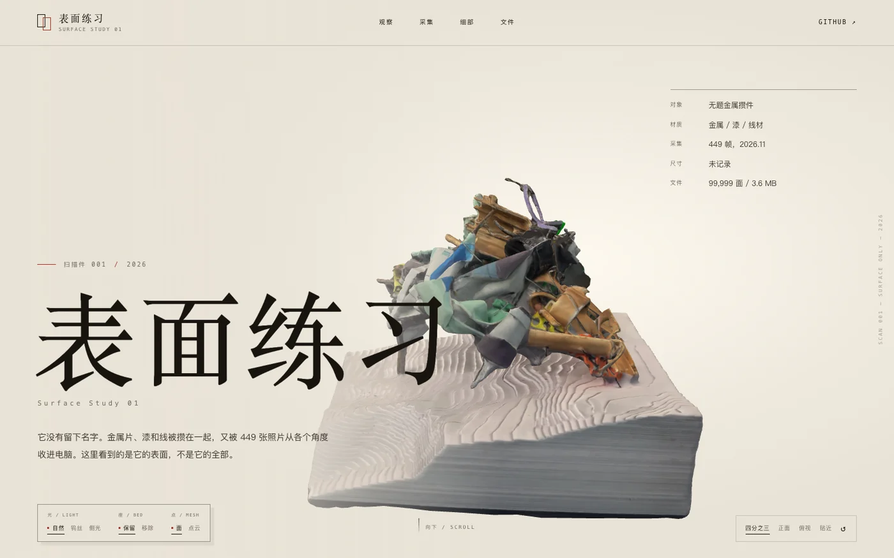

# 表面练习 01 / Surface Study 01

一枚无题金属攒件的数字扫描。黄铜片、漆、线材和一块白色泡沫底座，被 449 张照片收进电脑，又重新摊开成一个可以转动的表面。

在线看：<https://timicai8787-pixel.github.io/surface-study/>



## 这是什么

这不是一个产品页面，也不是把模型放进一个默认的 three.js 场景里。页面按一本印刷品的结构来组织：标题、图版、联系表、数据表，中间只放一个可以真正转动的对象。

模型本身没有修过。细线是断的，漆面是糊的，白色泡沫底座也被一起扫了进来。页面没有把这些痕迹抹平，而是把它们当作这次采集的一部分。

- 拖动旋转，滚轮或双指靠近。
- 「光」切换自然光、钨丝灯和侧光。
- 「座」显示或移除扫描底座（裁剪面在底座上表面，不是重新导出的模型）。
- 「点」把三角面换成点云；点的颜色直接采样自那张 2048 px 贴图。
- 视角预设：四分之三、正面、俯视、贴近。

## 数据

| | |
|---|---|
| 采集 | 449 帧，2026.11 |
| 原始文件 | FBX 7.5，51.4 MB，单网格 |
| 网格 | 50,019 顶点 / 99,999 三角面 |
| 贴图 | 原始 4,096² TGA / 网页 2,048² JPEG |
| 网页模型 | GLB，3.6 MB，Y-up |
| 页面 | three.js r180 · Vite 7 · GitHub Pages |

原始 FBX 和可下载的 GLB 在 [Releases](https://github.com/timicai8787-pixel/surface-study/releases)。

## 本地运行

```bash
npm install
npm run dev       # http://127.0.0.1:5180
npm run build     # dist/
npm run preview   # http://127.0.0.1:5181
```

需要 Node 20+。页面没有后端，所有内容都是静态文件。

## 结构

```
index.html
src/
  main.js        载入、滚动、控件
  viewer.js      three.js 场景、裁剪、点云、相机预设
  style.css      版式与响应式
public/
  models/study-01.glb
  images/        联系表与三张模型图版
scripts/
  convert_fbx.py Blender 转换脚本
docs/
  PIPELINE.md    从 FBX 到 GLB 的具体步骤
```

## 部署

`dist/` 是纯静态目录。当前线上版本从 `gh-pages` 分支发布；也可以把 `dist/` 交给任何静态托管。

```bash
npm run build
# 将 dist/ 发布到 gh-pages
```

## 制作

扫描、模型与页面：[@timicai8787-pixel](https://github.com/timicai8787-pixel)。

模型由摄影测量生成，页面与图版由 Blender 渲染。没有使用生成式图像。

## 许可

代码以 MIT 许可发布（见 `LICENSE`）。扫描模型仅用于这个页面的展示，未授予商用或再分发许可；如需使用原始模型，请先联系作者。
